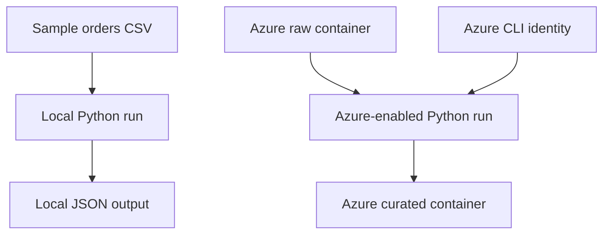

# Azure Data Engineering Pipeline

Run a Python batch job that reads orders from Azure Blob Storage and writes a regional sales summary to a curated container. Try the same transformation locally before connecting an Azure account.

## Architecture



## Run locally

1. Install Python 3.10 or newer, clone the repository, and open a terminal at its root.
2. Run `python pipeline.py`.
3. Open `output/regional-sales.json`. Expect three orders and totals of 20.00 for east and 16.00 for west. Amounts are serialized as strings to preserve decimal precision.

## Run with Azure Blob Storage

1. Install the Azure CLI and sign in with `az login`. Select your subscription with `az account set --subscription YOUR_SUBSCRIPTION` if you have more than one.
2. Create or choose an Azure Storage account. In the Azure portal, create private containers named `raw` and `curated`. Give your signed-in identity **Storage Blob Data Contributor** access scoped to those two containers. You may need a subscription administrator to assign the role.
3. Open the `raw` container in the Azure portal and upload `data/orders.csv` as `orders.csv`.
4. Create and activate a virtual environment. The commands below use a POSIX shell. On Windows PowerShell, activate it with `.\.venv\Scripts\Activate.ps1`, and set environment variables with `$env:NAME = "value"`.

   ```sh
   python -m venv .venv
   . .venv/bin/activate
   python -m pip install -r requirements.txt
   export AZURE_STORAGE_ACCOUNT_URL=https://YOUR_ACCOUNT.blob.core.windows.net
   python pipeline.py --azure
   ```

5. Open `curated/regional-sales.json` in the portal and compare it with the local result. A rerun replaces that output after transformation succeeds. A 403 can indicate that your CLI identity lacks blob data access or that your new role assignment is still propagating.

Azure storage and requests may incur charges. When finished, remove the containers or storage account you created specifically for this demo if you no longer need them.
